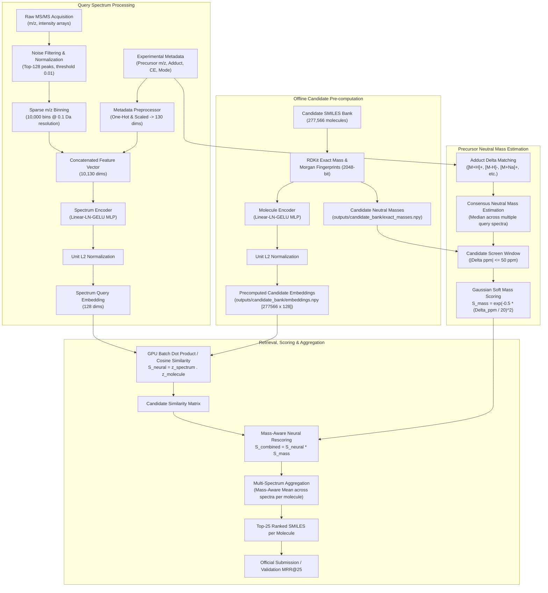

# Enveda CASMI 2026: System Architecture & Technical Design

**Document ID:** `docs/ARCHITECTURE.md`  
**Competition:** Enveda CASMI 2026 — Molecule Identification from Mass Spectra  
**Primary Metric:** Mean Reciprocal Rank truncated at 25 (MRR@25)  
**System Type:** Dual-Tower Neural Retrieval with Chemistry-Conditioned Hard-Negative Sampling, Precursor Neutral Mass Scoring, and Multi-Spectrum Molecule Aggregation  

---

## 1. Architectural Overview

The core objective is to retrieve and rank candidate molecular structures ($SMILES$) from an open candidate database given one or more tandem mass spectrometry ($\text{MS/MS}$ or $\text{MS}^2$) experimental acquisitions.

The system solves this via a decoupled **Dual-Tower Retrieval and Reranking Architecture**:
1. **Spectrum Tower:** Transforms sparse fragment ion peak arrays and experimental metadata into a 128-dimensional L2-normalized embedding.
2. **Molecule Tower:** Transforms 2048-bit Morgan circular molecular fingerprints into a 128-dimensional L2-normalized embedding in the identical latent space.
3. **Precursor Neutral Mass Filter & Soft Scorer:** Estimates consensus neutral mass from experimental precursor $m/z$ and adduct hypotheses, screening candidate molecules within $\pm 50\text{ ppm}$ and applying a Gaussian soft mass compatibility multiplier ($\sigma = 20\text{ ppm}$).
4. **Molecule-Level Aggregation:** Aggregates predictions across multiple spectra belonging to the same unknown molecule using mass-aware mean score fusion.

---

## 2. Mermaid System Architecture Diagram

---

## 3. Data Preprocessing & Feature Representations

### 3.1 Sparse Spectrum Binning
Raw mass spectra consist of variable-length lists of $(m/z, \text{intensity})$ pairs.
1. **Noise Thresholding:** Intensities are normalized to relative base peak intensity ($I_{\text{rel}} = I / I_{\max}$). Peaks with $I_{\text{rel}} < 0.01$ are discarded.
2. **Dynamic Top-K Filtering:** The spectrum is restricted to the top $K = 128$ most intense fragment ions.
3. **Fixed-Resolution Binning:** $m/z$ values ranging from $0.0$ to $1000.0\text{ Da}$ are binned into $N = 10,000$ uniform intervals ($\Delta m/z = 0.1\text{ Da}$):
   $$\text{bin}(m/z) = \min\left(\lfloor m/z / 0.1 \rfloor, 9999\right)$$
4. **Vector Normalization:** The resulting 10,000-dimensional sparse vector $x_{\text{spec}}$ is L2-normalized:
   $$\tilde{x}_{\text{spec}} = \frac{x_{\text{spec}}}{\|x_{\text{spec}}\|_2}$$

### 3.2 Metadata Feature Engineering
Experimental metadata strongly constraints the ionization physics and fragmentation pathway:
- **Precursor $m/z$:** Continuous float, standardized by z-score scaling.
- **Collision Energy:** Extracted nominal and spread statistics (continuous, standardized).
- **Ionization Mode:** Categorical binary flag (`POSITIVE`, `NEGATIVE`).
- **Adduct Type:** One-hot categorical encoding across 15 recognized adduct species (`[M+H]+`, `[M-H]-`, `[M+Na]+`, `[M+NH4]+`, `[M-H2O+H]+`, etc.).
- **Instrument Type:** One-hot categorical encoding.

Total metadata vector dimension: $D_{\text{meta}} = 130$.

The concatenated spectrum input vector has dimension:
$$D_{\text{in\_spec}} = 10,000 + 130 = 10,130$$

### 3.3 Molecular Structural Representation
Candidate molecular structures represented as SMILES strings are processed via **RDKit**:
1. Canonicalization: Strict SMILES sanitization and stripping of stereochemistry ambiguity where appropriate.
2. Extended Connectivity Fingerprints (ECFP4 / Morgan Circular Fingerprints):
   - Radius $r = 2$ (representing bond diameters up to 4 bonds).
   - Length $B = 2048$ bits.
   - Vector format: dense binary float tensor $x_{\text{mol}} \in \{0.0, 1.0\}^{2048}$.

---

## 4. Model Architecture

Both towers map their disparate input spaces into a shared unit hypersphere $\mathbb{S}^{127} \subset \mathbb{R}^{128}$.

### 4.1 Spectrum Encoder (`SpectrumEncoder`)
An expressive multi-layer perceptron with Layer Normalization and GELU non-linearities:

$$\begin{aligned}
h_0 &= [ \tilde{x}_{\text{spec}} \,\|\, x_{\text{meta}} ] \in \mathbb{R}^{10130} \\
h_1 &= \text{Dropout}_{0.2}(\text{GELU}(\text{LayerNorm}(\mathbf{W}_1 h_0 + b_1))) \quad (\mathbf{W}_1 \in \mathbb{R}^{512 \times 10130}) \\
h_2 &= \text{Dropout}_{0.1}(\text{GELU}(\text{LayerNorm}(\mathbf{W}_2 h_1 + b_2))) \quad (\mathbf{W}_2 \in \mathbb{R}^{256 \times 512}) \\
h_3 &= \mathbf{W}_3 h_2 + b_3 \quad (\mathbf{W}_3 \in \mathbb{R}^{128 \times 256}) \\
z_{\text{spec}} &= \frac{h_3}{\|h_3\|_2} \in \mathbb{S}^{127}
\end{aligned}$$

### 4.2 Molecule Encoder (`MoleculeEncoder`)
$$\begin{aligned}
m_0 &= x_{\text{mol}} \in \mathbb{R}^{2048} \\
m_1 &= \text{Dropout}_{0.2}(\text{GELU}(\text{LayerNorm}(\mathbf{V}_1 m_0 + c_1))) \quad (\mathbf{V}_1 \in \mathbb{R}^{512 \times 2048}) \\
m_2 &= \text{Dropout}_{0.1}(\text{GELU}(\text{LayerNorm}(\mathbf{V}_2 m_1 + c_2))) \quad (\mathbf{V}_2 \in \mathbb{R}^{256 \times 512}) \\
m_3 &= \mathbf{V}_3 m_2 + c_3 \quad (\mathbf{V}_3 \in \mathbb{R}^{128 \times 256}) \\
z_{\text{mol}} &= \frac{m_3}{\|m_3\|_2} \in \mathbb{S}^{127}
\end{aligned}$$

---

## 5. Precursor Neutral Mass & Gaussian Soft Scoring

### 5.1 Adduct Chemistry & Consensus Neutral Mass
Given an observed precursor ion mass-to-charge ratio $m/z_{\text{prec}}$, charge $z$, and adduct assignment, the estimated neutral monoisotopic mass $M_{\text{neutral}}$ is computed via mass conservation:

$$M_{\text{neutral}} = \frac{m/z_{\text{prec}} \cdot |z| - \Delta m_{\text{adduct}}}{1.0}$$

Where $\Delta m_{\text{adduct}}$ is exact monoisotopic adduct mass shift:
- `[M+H]+`: $+1.007276\text{ Da}$
- `[M-H]-`: $-1.007276\text{ Da}$
- `[M+Na]+`: $+22.989218\text{ Da}$
- `[M+NH4]+`: $+18.033823\text{ Da}$
- `[M+K]+`: $+38.963158\text{ Da}$
- `[M-H2O+H]+`: $-17.003288\text{ Da}$

When a molecule has multiple query spectra with differing adducts or collision energies, the system computes the **consensus neutral mass**:
$$\bar{M}_{\text{consensus}} = \text{median}\left(\{M_{\text{neutral}}^{(s)}\}_{s=1}^{S}\right)$$

### 5.2 Gaussian Soft Mass Compatibility
Rather than using a brittle hard cutoff, the neural similarity is modulated by a smooth Gaussian penalty based on parts-per-million (ppm) mass error:

$$\Delta\text{ppm}(c) = \frac{|M_{\text{candidate}}(c) - \bar{M}_{\text{consensus}}|}{\bar{M}_{\text{consensus}}} \times 10^6$$

$$S_{\text{mass}}(c) = \exp\left(-\frac{1}{2}\left(\frac{\Delta\text{ppm}(c)}{\sigma}\right)^2\right) \quad (\text{with } \sigma = 20.0\text{ ppm})$$

For candidates with $\Delta\text{ppm} > 50\text{ ppm}$, $S_{\text{mass}} = 0.0$, acting as an efficient candidate filter while retaining a $98.00\%$ theoretical target survival rate.

The combined retrieval score for candidate $c$ and spectrum $s$ is:
$$S_{\text{combined}}(s, c) = \langle z_{\text{spec}}^{(s)}, z_{\text{mol}}^{(c)} \rangle \times S_{\text{mass}}(c)$$

---

## 6. Multi-Spectrum Molecule-Level Aggregation

In the CASMI competition, a single test molecule may produce between 1 and 16 experimental spectra recorded under varied collision energies and adduct forms.

The primary ranking score for candidate $c$ with respect to molecule $m$ is the **Mass-Aware Mean Score**:

$$S_{\text{agg}}(m, c) = \frac{1}{|S_m|} \sum_{s \in S_m} S_{\text{combined}}(s, c)$$

Candidates are sorted in descending order of $S_{\text{agg}}(m, c)$, and the top 25 candidate SMILES strings are outputted.

